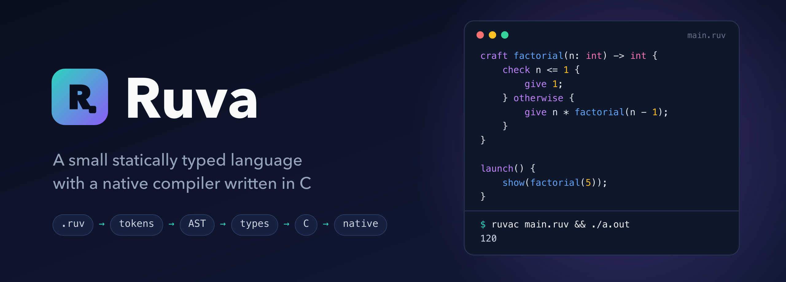
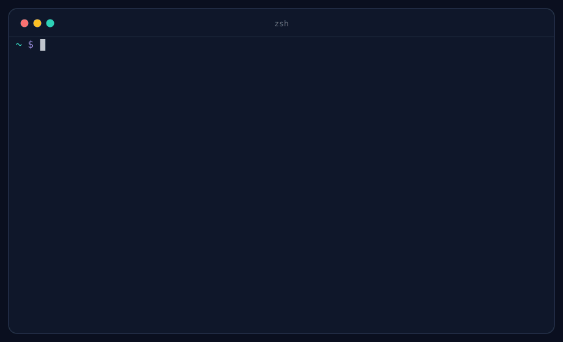

<p align="center">
  
</p>

<p align="center">
  
  
  
  
</p>

Ruva is a small statically typed programming language with its own compiler, `ruvac`. The compiler reads `.ruv` files, checks them, turns them into C and builds a native executable with GCC or Clang.

<p align="center">
  
</p>

## Features

- Static types with `int`, `real`, `bool` and `text`, plus records and arrays
- Functions with parameters, return values and recursion
- `check` and `otherwise`, `choose` and `when`, `walk` loops and `during` loops
- Records with field access, copies and walks over their fields
- Arrays with `push`, `pop`, `length` and checked indexing
- Modules across several files with `share` and `bring`
- Typed keyboard input, conversions and file operations
- Checked integer arithmetic and errors that point to the exact line and column

## Quick start

You need a C11 compiler (GCC or Clang), Flex, Make and Python 3.9 or later.

```sh
git clone https://github.com/khalid999devs/Ruva.git
cd Ruva
make
export PATH="$PWD/build/debug/bin:$PATH"
```

Now `ruvac` works from any folder.

```sh
cd examples/hello
ruvac main.ruv
./a.out
```

This prints `Hello from Ruva`.

## A taste of Ruva

```
craft factorial(n: int) -> int {
    check n <= 1 {
        give 1;
    } otherwise {
        give n * factorial(n - 1);
    }
}

craft repeat(word: text, count: int) -> text {
    vary result = "";

    walk index from 0 until count {
        result = result + word;
    }

    give result;
}

launch() {
    show(factorial(5), repeat("ru", 3));
}
```

```
$ ruvac main.ruv && ./a.out
120 rururu
```

## Using the compiler

```sh
ruvac main.ruv                          # check, emit C and build a.out
ruvac main.ruv -o app                   # pick the executable name
ruvac --check main.ruv                  # check the program and its imports only
ruvac --emit-c main.ruv -o main.c       # write the generated C
ruvac --sanitize main.ruv -o app        # build with AddressSanitizer and UBSan
```

A successful compile prints nothing, and errors show the file, line and column. For a program split into modules, compile only the entry file and `ruvac` follows its `bring` imports.

## Examples

| Example | What it shows | Output |
| --- | --- | --- |
| [`hello`](examples/hello/main.ruv) | Entry point and `show` | `Hello from Ruva` |
| [`functions`](examples/functions/main.ruv) | Recursion and a counted loop | `120 rururu` |
| [`collections`](examples/collections/main.ruv) | Arrays, records and walks | `12 3` and the record fields |
| [`io`](examples/io/main.ruv) | Keyboard input and file writing | Writes and reads `message.txt` |
| [`modules`](examples/modules/main.ruv) | Four files sharing a record | `Asha: 42 (pass)` |

## How it works

```
.ruv source  →  tokens  →  AST  →  modules  →  type checks  →  C  →  native executable
```

| Stage | Location |
| --- | --- |
| Lexer built with Flex | [`compiler/frontend/lexer`](compiler/frontend/lexer) |
| Recursive descent parser and AST | [`compiler/frontend/parser`](compiler/frontend/parser), [`compiler/frontend/ast`](compiler/frontend/ast) |
| Module graph and type checks | [`compiler/analysis`](compiler/analysis) |
| C code generation | [`compiler/backend/c`](compiler/backend/c) |
| Command line and native build | [`compiler/driver`](compiler/driver) |
| Runtime for text, arrays, input and files | [`runtime`](runtime) |

## Testing

```sh
make test       # 7 C suites, 177 program fixtures and 76 Python tests
make sanitize   # the same checks with AddressSanitizer and UBSan
make clean
```

<details>
<summary>Build options</summary>

<br>

Pick the compiler and flags with a separate output folder for each setup.

```sh
make CC=clang BUILD_DIR=build/clang test
make CC=gcc BUILD_DIR=build/gcc CFLAGS="-O2 -g" test
```

Native builds use the runtime sources from this checkout. The driver finds them next to its executable, or through `RUVA_RUNTIME_ROOT` pointing at the `runtime` folder.

</details>

<details>
<summary>Windows</summary>

<br>

A Windows x64 build with [MSYS2 UCRT64](https://www.msys2.org/docs/environments/) GCC is prepared and its build and link checks pass, but it has not been run on a real Windows machine yet. In the UCRT64 terminal:

```sh
pacman -S --needed make flex mingw-w64-ucrt-x86_64-gcc mingw-w64-ucrt-x86_64-python
make -j4 CC=gcc PYTHON=python BUILD_DIR=build/windows windows-test
```

This builds `build/windows/bin/ruvac.exe`.

</details>

<details>
<summary>Inspection tools</summary>

<br>

```sh
build/debug/tests/lexer/lexer-probe tests/fixtures/lexer/literals/input.ruv
build/debug/tests/parser/parser-probe tests/fixtures/parser/expression/input.ruv
build/debug/tests/semantic/semantic-probe --summary tests/fixtures/semantic/imports/input.ruv
```

These print the tokens, the syntax tree and the checked module summary of a program.

</details>

## Author

Built by [khalid999devs](https://github.com/khalid999devs).
