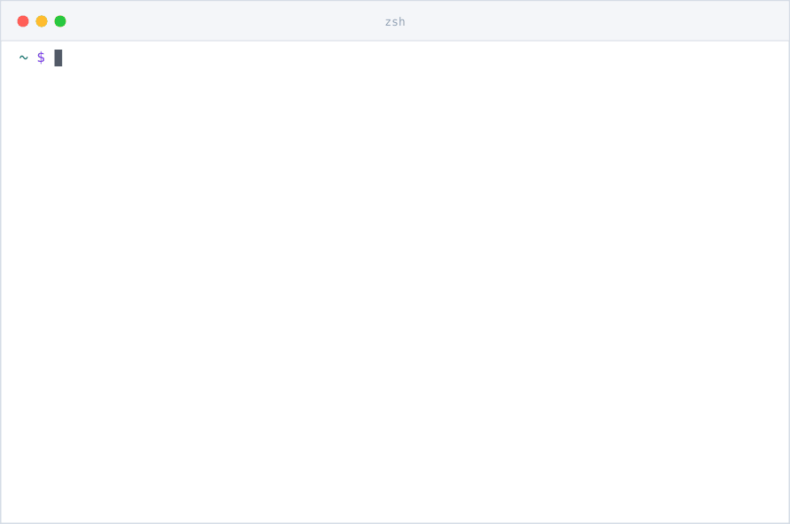

---
hide:
  - navigation
  - toc
---

<div class="ruva-hero" markdown>

{ width="84" }

# Ruva

<p class="tagline">A small statically typed language with a native compiler written in C.</p>

[Install Ruva](start/install.md){ .md-button .md-button--primary }
[Learn the language](basics/program.md){ .md-button }

</div>



Ruva is a language you can read in an afternoon. Its compiler, `ruvac`, checks your program, turns it into C and builds a native executable with GCC or Clang. You write a `.ruv` file, run one command and get a program that runs on its own.

```ruva
craft square(n: int) -> int {
    give n * n;
}

launch() {
    show("7 squared is", square(7));
}
```

```sh
ruvac main.ruv -o square
./square
```

```text
7 squared is 49
```

## What you get

<div class="grid cards" markdown>

-   **Static types**

    `int`, `real`, `bool` and `text`, plus records and arrays. Mistakes are caught before the program runs.

-   **Native programs**

    Every program becomes C and then a real executable. No virtual machine and nothing to install for the people who run it.

-   **Clear errors**

    Errors name the file, the line and the column, so you know where to look.

-   **Modules**

    Split a program across files with `share` and `bring`, then compile the entry file only.

</div>

## Where to go next

1. [Install Ruva](start/install.md) and put `ruvac` on your path.
2. Write [your first program](start/first-program.md).
3. Learn the language from [program structure](basics/program.md) to [modules](programs/modules.md).
4. Keep the [built-in functions](reference/builtins.md) and the [syntax summary](reference/syntax.md) open while you code.

## Learn by contributing

Ruva is small on purpose. The lexer, parser, type checker, C generator and runtime all live in one repository that you can read end to end. If you want to understand how compilers work, fixing an error message or adding a test is a good way in. The [contributor guide](contributing/index.md) walks you from your first build to your first pull request.

Ruva is open source under the [MIT License](https://github.com/khalid999devs/Ruva/blob/main/LICENSE).
